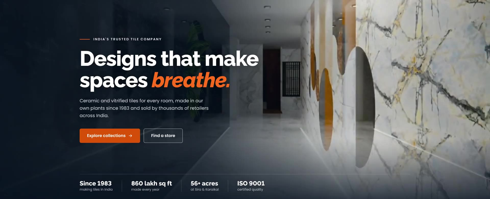

# Naveen Tile: homepage video hero

A full-width video hero for naveentile.com. A 16-second loop of Naveen's own
showroom plays behind the headline, two buttons and a slim proof bar.



**The footage is theirs.** It is cut from the 98-second showroom walkthrough
already on the site (`/wp-content/themes/Naveentile/video/banner-video.mp4`):
five clean shots, slowed to 80% so the camera feels calm, joined with soft
dissolves. The end dissolves back into the start, so the loop has no jump.

| # | Shot | Source time |
|---|---|---|
| 1 | Dark marble corridor (first frame and poster) | 23.00–26.60s |
| 2 | Marble slab gallery | 37.25–39.90s |
| 3 | Tile rack corridor | 56.20–59.45s |
| 4 | Close-up of tile samples | 60.15–61.85s |
| 5 | Glossy marble corridor | 86.60–90.50s |

## Files

| File | What it is |
|---|---|
| `preview.html` | Open in a browser. The hero markup (with its small script) sits between `HERO START` and `HERO END` |
| `hero.css` | All styles, scoped under `.nt-vhero`. Tested against the live theme CSS: renders pixel-identically |
| `media/naveen-hero-loop-1920x780.{webm,mp4}` | Background loop for desktop. 2.7 MB / 3.2 MB |
| `media/naveen-hero-loop-720x900.{webm,mp4}` | Background loop for phones, 4:5 centre crop. 1.0 MB / 1.1 MB |
| `media/*-poster.{webp,jpg}` | First frame, shown before the video starts |
| `exports/naveen-hero-banner-1920x780.mp4` | Same loop with the text built in, for the existing slider slot. 3.1 MB |
| `exports/naveen-hero-banner-720x900.mp4` | Phone version with the text built in. 1.0 MB |
| `exports/*.jpg` | First frames, for client approval |
| `build_video.py` | Re-cuts the loop from the source video |
| `render.cjs` | Re-makes the text-in videos after copy changes |

## Two ways to put it live

### A. Coded section (recommended)

1. Upload everything in `media/` to `/wp-content/themes/Naveentile/video/`
2. In the theme's front-page template, replace the whole
   `<section class="home-sec"> … </section>` block with the markup between
   `HERO START` and `HERO END` in `preview.html`, and change every `media/` to
   `/wp-content/themes/Naveentile/video/`
3. Add `hero.css` to the theme: paste it at the end of `revamp-style.css`, or
   enqueue it as its own file
4. Add the poster preload from `preview.html`'s `<head>` to the site's `<head>`
5. Change the next section's heading, *"Your Trusted India's No.1 Tile
   Company"*, from `<h1>` to `<h2>`. The hero now holds the page's one H1

### B. Swap the video in the existing slider

If the theme can't be edited, upload the two `exports/` videos and change the
slider's video slide to:

```html
<video autoplay muted loop playsinline preload="metadata" width="100%"
       poster="/PATH/naveen-hero-banner-1920x780.jpg">
  <source media="(max-width: 767px)" src="/PATH/naveen-hero-banner-720x900.mp4" type="video/mp4">
  <source src="/PATH/naveen-hero-banner-1920x780.mp4" type="video/mp4">
</video>
```

The text is part of the picture in this version, so search engines can't read
it and the buttons can't be clicked. Link the slide to `/products/`.

## What changes for the site

| | Current video slide | New hero |
|---|---|---|
| File size | 25 MB, downloaded in full on load (`preload="auto"`) | 3.2 MB desktop, 1.1 MB phone |
| Length | 98 s, plays once | 16 s, loops with no jump |
| Phones | Full 2256×916 file | Own 720×900 file |
| Headline | None | Live H1 that search engines can read |
| Motion settings | Ignored | Nothing downloads for visitors who ask for less motion or use data saver; a still frame shows instead |
| Battery | Keeps running | Pauses when scrolled out of view |
| Pause button | None | Yes, which accessibility guidelines (WCAG 2.2.2) require for moving content longer than 5 s |

## Where each claim comes from

| On the banner | Source |
|---|---|
| Since 1983 | Homepage: "Tile Manufacturing Excellence Since 1983" |
| 860 lakh sq ft made every year | `/manufacturers/`: "production capacity of 860 lakh sqft per year" |
| 56+ acres at Sira & Karaikal | `/manufacturers/`: "spread across 56+ acres in Sira (Tumakuru) and Karaikal (Pondicherry)" |
| ISO 9001 | `/manufacturers/` and the certificate image on the homepage (see caveats) |
| Thousands of retailers across India | Homepage: "We work with thousands of retailers across India" |
| "Designs that make spaces breathe" | Tagline on the current banner |

The kicker says *"India's trusted tile company"*, not *"India's No.1"*. It keeps
the "tile company" keyword without making a ranking claim that can't be shown.

## Design notes

- **Readability:** a navy fade sits behind the text. It is measured from where
  the text column starts, not from the screen edge, so it covers the copy at
  every width, even over the brightest white marble shots
- **Colours:** brand orange `#F26522` for "breathe." and the accent rule. The
  button uses `#CF4B0C`, the same hue darkened just enough for white text to
  meet WCAG AA (4.5:1)
- **Grade:** only a touch of contrast and saturation (4%), so tile colours stay true
- **Numbers:** `lining-nums` stops Raleway's default numerals dropping below the line
- **Alignment:** the copy's left edge follows Bootstrap's `.container` at each
  breakpoint, so it lines up with the header logo

## Rebuilding

```bash
python3 build_video.py                     # re-cut media/ from the source video
NODE_PATH=$(npm root -g) node render.cjs   # re-make exports/ after copy changes
```

Needs ffmpeg (libx264, libvpx-vp9) and Playwright with Chromium.

## Caveats

- **The footage is a 3D render** of the showroom, not filmed. It's Naveen's
  own and shows their tiles, but if they have a real filmed walkthrough or a
  higher-quality export of this render, point `build_video.py` at it and
  everything else stays the same
- **Very old browsers** (Chrome or Firefox before late 2023) ignore the
  phone/desktop switch and play the phone file on desktop: a little soft, but it works
- **ISO version mismatch on their site:** `/manufacturers/` says
  "ISO 9001-2000", but the certificate image reads "ISO 9001:2015". The banner
  says just "ISO 9001"
- **Dead tile links:** 54 tile links on the homepage (menu and footer lists by
  area, design, type, colour and collection) point to `#`. A quick SEO fix
