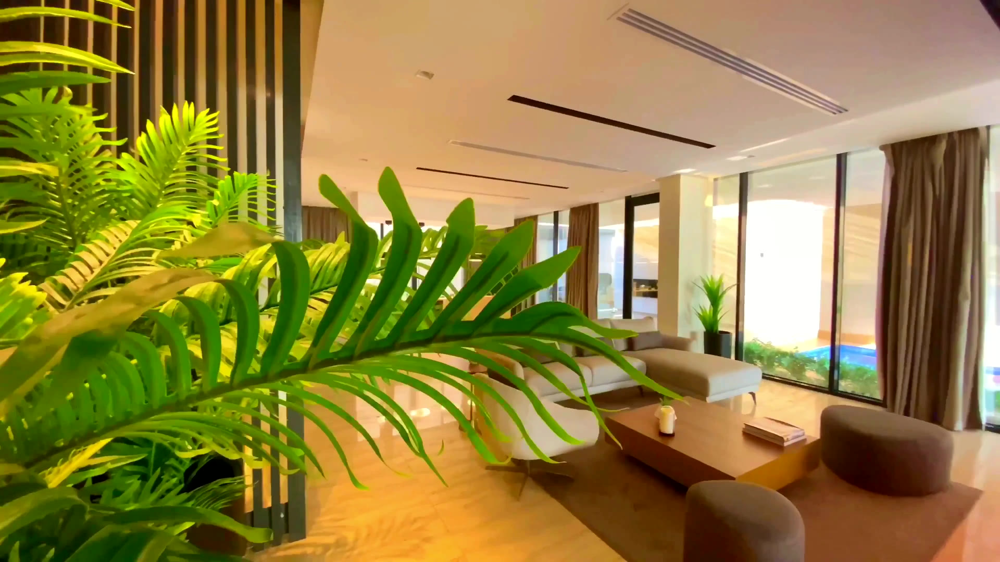

# Naveen Tile: homepage hero video

A clean, cinematic background video for the naveentile.com homepage hero:
17.5 seconds of real filmed luxury interiors, glossy tiled floors and marble,
looping with no visible jump. It has **no text and no buttons**, so the
headline and calls to action can be added during web development.



## Files (`media/`)

| File | Use | Size |
|---|---|---|
| `naveen-hero-1920x1080.webm` / `.mp4` | Desktop and tablet (16:9) | 5.7 MB / 6.3 MB |
| `naveen-hero-1080x1920.webm` / `.mp4` | Phones (9:16, reframed per shot) | 4.3 MB / 5.2 MB |
| `naveen-hero-1280x720.mp4` | Lighter fallback for slow connections | 3.1 MB |
| `*-poster.webp` / `.jpg` | First frame of each, shown while the video loads | 60–270 KB |

For comparison, the video on the homepage today is 25 MB and downloads in full on page load.

`preview.html` plays the right file for the screen size, full screen, with nothing on top.

## The edit

| # | Shot | Pexels clip | Treatment |
|---|---|---|---|
| 1 | Palm leaves part to reveal a sunlit villa lounge | [5744429](https://www.pexels.com/video/a-footage-of-an-interior-of-a-house-5744429/) | 4.0 s, normal speed |
| 2 | High, slow glide over a living room with a glossy floor and pool | [18531410](https://www.pexels.com/video/the-living-room-has-a-large-flat-screen-tv-and-a-pool-18531410/) (Abdullah \| 4K) | 60 fps at half speed |
| 3 | Water running over a black marble block | [9166288](https://www.pexels.com/video/water-dripping-on-the-floor-9166288/) (Ron Lach) | Slowed to 83% |
| 4 | Sunlight falling across a tiled floor, from above | [5744421](https://www.pexels.com/video/video-of-a-living-room-5744421/) | Normal speed |
| 5 | Marble-clad bathroom | [39024338](https://www.pexels.com/video/luxurious-modern-bathroom-with-marble-finish-39024338/) (Alef Morais) | Normal speed |
| 6 | Glide across a glossy marble floor into the dining area | [11630727](https://www.pexels.com/video/showcase-of-modern-home-interior-11630727/) | Slowed to 83% |

The shots are joined with 0.6-second dissolves, and the last shot dissolves back into the first.
All sources are 4K except shot 4 (1440p), so both the 16:9 and 9:16 versions stay sharp.
Grading is kept light (4–5% contrast and saturation) so tile colours stay true.

**Licence:** every clip is from Pexels, free for commercial use with no attribution
required, and editing is allowed ([Pexels License](https://www.pexels.com/license/)).
No people appear in any shot. Credits are listed above anyway.

## Embedding

```html
<section class="hero">
  <video class="hero__video" autoplay muted loop playsinline preload="auto"
         poster="/PATH/naveen-hero-1920x1080-poster.webp">
    <source media="(max-width: 767px)" src="/PATH/naveen-hero-1080x1920.webm" type="video/webm">
    <source media="(max-width: 767px)" src="/PATH/naveen-hero-1080x1920.mp4" type="video/mp4">
    <source src="/PATH/naveen-hero-1920x1080.webm" type="video/webm">
    <source src="/PATH/naveen-hero-1920x1080.mp4" type="video/mp4">
  </video>
  <!-- headline and buttons go here -->
</section>

<style>
  .hero { position: relative; height: 100svh; min-height: 560px; overflow: hidden; }
  .hero__video { position: absolute; inset: 0; width: 100%; height: 100%; object-fit: cover; }
</style>
```

Notes for the developer:

- **Text on top:** most frames are bright, so put a dark gradient behind any white text
- **Pause button:** accessibility guidelines (WCAG 2.2.2) require a way to pause
  moving content that runs longer than 5 seconds
- **Reduced motion:** for visitors with "reduce motion" turned on, pause the
  video so they see the still poster frame instead
- **First paint:** preload the poster in `<head>` so the hero is never blank:
  `<link rel="preload" as="image" href="/PATH/naveen-hero-1920x1080-poster.webp" fetchpriority="high">`

## Rebuilding

```bash
python3 build_video.py
```

This downloads the six source clips from Pexels into `.cache/` (not committed),
then rebuilds everything in `media/`. To change a shot, edit its `start`, `end`,
`speed` or crop in the `SHOTS` list. Needs ffmpeg with libx264 and libvpx-vp9.
It takes about 7 minutes.

## Caveat

This is stock footage of well-designed interiors, not Naveen's own products.
That's fine as mood footage behind a headline. If Naveen later shoots its own
showroom, factory or a finished project in 4K, swap those clips into `SHOTS`
and everything else stays the same.
