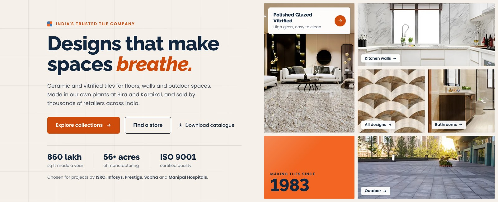

# Naveen Tile: homepage hero banner

A new hero for naveentile.com, replacing the current collage slide
(`home-sec-banner-img-1.webp`, all text baked into the picture, `alt="Image"`).



**The idea:** the banner is laid like a tiled floor. Photos of Naveen's own
collections sit in a grid with even grout lines, with one brand-orange tile
("Making tiles since 1983") set among them. Each photo tile links to its
category page, so the hero also works as a way into the catalogue.

| File | What it is |
|---|---|
| `preview.html` | Standalone page. Open it in a browser. The hero markup sits between `HERO START` and `HERO END` |
| `hero.css` | All styles, scoped under `.nt-hero`. Tested against the live theme CSS: renders pixel-identically |
| `exports/naveen-hero-1600x650.webp` | Drop-in replacement for the current slide (same size). 81 KB |
| `exports/naveen-hero-mobile-800x1120.webp` | Phone version of the slide. 72 KB |
| `exports/*.jpg` | Same images as JPG, for sending to the client for approval |
| `render.cjs` | Re-creates the exports after any copy change |

---

## Two ways to put it live

### A. Coded section (recommended)

1. In the theme's front-page template, replace the whole
   `<section class="home-sec"> … </section>` block with the markup between
   `HERO START` and `HERO END` in `preview.html`
2. Add `hero.css` to the theme: paste it at the end of `revamp-style.css`, or
   enqueue it as its own file
3. Change the next section's heading, *"Your Trusted India's No.1 Tile
   Company"*, from `<h1>` to `<h2>`. The hero now holds the page's one H1

Raleway and Poppins are already loaded by the theme, so no font changes are needed.
The images are the ones already on the server under
`/wp-content/themes/Naveentile/webp/`, so nothing needs uploading.

Why this is better than an image:

- **Search engines can read the headline.** The H1 becomes *"India's trusted tile
  company: Designs that make spaces breathe."* Today that text is pixels in a picture
- **It's readable on phones.** A 1600×650 image shrinks to about 390×158 on a
  phone, leaving the text roughly 40% of its size. The coded version stacks the
  text above the photos instead
- **Five crawlable links** from the top of the homepage into category pages
  (Polished GVT, kitchen walls, bathrooms, outdoor, all products)
- **A faster largest paint.** The headline is text and paints immediately. The
  photos are already used further down the homepage, so the browser loads each
  once for both sections

### B. Image slide (if the theme can't be edited)

Upload the two WebP files and swap the first slide's `` for:

```html
<a href="https://naveentile.com/products/">
  <picture>
    <source media="(max-width: 575px)" srcset="/PATH/naveen-hero-mobile-800x1120.webp" width="800" height="1120">
    
  </picture>
</a>
```

The buttons drawn in the image can't be clicked on their own, so the whole slide links to `/products/`.

---

## Where each claim comes from

Every fact on the banner is taken from naveentile.com, nothing invented.

| On the banner | Source |
|---|---|
| Making tiles since 1983 | Homepage: "Tile Manufacturing Excellence Since 1983" |
| Plants at Sira and Karaikal; 56+ acres | `/manufacturers/`: "spread across 56+ acres in Sira (Tumakuru) and Karaikal (Pondicherry)" |
| 860 lakh sq ft made a year | `/manufacturers/`: "production capacity of 860 lakh sqft per year" |
| Thousands of retailers across India | Homepage: "We work with thousands of retailers across India" |
| ISO 9001 | `/manufacturers/` and the certificate image on the homepage (see caveats) |
| ISRO, Infosys, Prestige, Sobha, Manipal Hospitals | Homepage client logo wall |
| "Designs that make spaces breathe" | Tagline on the current banner |

The kicker says *"India's trusted tile company"*, not *"India's No.1"*. It keeps
the "tile company" keyword without making a ranking claim that can't be shown.

## Design notes

- **Colours:** brand orange `#F26522` and brand blue `#4279B7`, taken from the
  site. Headline navy `#13283F` is a deep shade of the brand blue. The background
  `#F5F0E9` is a warm ceramic off-white
- **Contrast:** white text on `#F26522` is only 3.15:1, below the 4.5:1 WCAG AA
  minimum. Buttons and orange text use `#CF4B0C`, the same hue darkened just
  enough to pass (4.5:1). The big orange tile keeps the exact brand colour and
  uses navy text (4.75:1)
- **Numbers:** Raleway's default numerals sit below the line. `lining-nums` keeps
  "1983" and "9001" on the baseline
- **Motion:** the smaller tiles fade in one after another, as if being laid.
  The feature tile does not animate, because it is likely the page's largest
  paint. Everything stays still for visitors who turn off motion
- **Alignment:** the copy's left edge follows Bootstrap's `.container` at each
  breakpoint, so it lines up with the header logo

## Re-rendering the images

After editing copy in `preview.html` or styles in `hero.css`:

```bash
NODE_PATH=$(npm root -g) node render.cjs
```

The script warns if the copy grows taller than the 650px slot.

## Caveats

- **The source photos are small** (450–535px wide). They look fine at normal
  size but slightly soft on high-density screens. If Naveen has the original
  renders, swap them in at about 2× size and nothing else needs to change
- **ISO version mismatch on their site:** `/manufacturers/` says
  "ISO 9001-2000", but the certificate image on the homepage reads
  "ISO 9001:2015". The banner says just "ISO 9001". Worth having them fix the
  page copy
- **Dead tile links:** 54 tile links on the homepage point to `#`. They cover
  the menu and footer lists of tiles by area, design, type, colour and
  collection (Mosaic, Marble, Wooden, Terracotta, Sparkle and the rest). That's
  54 internal links passing nothing to category pages. A quick SEO fix
